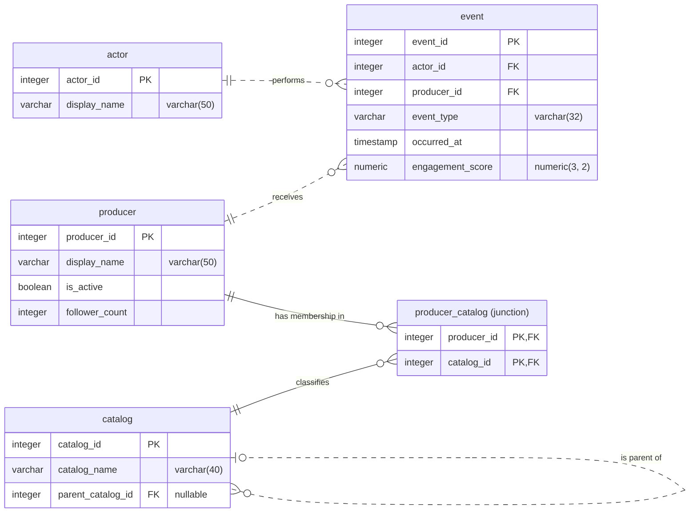

# E603 Social Media Database Project

## The domain
The theme is social media.

Todo: Add questions the platform must answer. Two to three paragraphs.

#### The five roles

| Role | What it is | Always has |
| --- | --- | --- |
| **actor** | The user who consumes or interacts with content. | A primary key and a display name. |
| **producer** | The user or account that creates content. | A primary key, a display name, an activity flag, and a numeric attribute used for filtering. |
| **event** | A recorded action in which an actor consumes or interacts with content created by a producer. | Foreign keys to actor and producer, a timestamp, and a numeric metric you will aggregate. |
| **catalog** | A category or topic used to classify content or producers. | A primary key and a name. |
| **junction** | The many-to-many link between producers and catalog categories or topics. | A composite primary key over foreign keys to producer and catalog. |

## Schema

The build script is [`schema/schema.sql`](schema/schema.sql). It drops these five tables in reverse dependency order and creates them again, so the same file can be run more than once. Relation schemas: [`schema/schema-definition.md`](schema/schema-definition.md) · constraints: [`schema/constraints.md`](schema/constraints.md) · reasoning: [`analysis/unit2.md`](analysis/unit2.md) · ERD: [`schema/erd.md`](schema/erd.md) · image: [`schema/erd.png`](schema/erd.png)



Cardinality: `||` exactly one · `|o` zero or one · `o{` zero or more · `..` non-identifying · `--` identifying. `producer` and `catalog` are many-to-many through `producer_catalog`. A catalog may also name one parent catalog.

| Table | What it stores |
| --- | --- |
| `actor` | The person who acts. Integer identity key and a display name. |
| `producer` | The account the action is about. Display name, `is_active`, and `follower_count`. |
| `event` | One recorded action: who did it, which producer it concerns, the action type, when it happened, and an engagement score. |
| `catalog` | A topic. It may sit under another topic through `parent_catalog_id`. |
| `producer_catalog` | Which topics a producer belongs to. The primary key is `(producer_id, catalog_id)`. |

Decisions worth noticing:

- Surrogate keys are `INTEGER GENERATED ALWAYS AS IDENTITY`. Primary keys, foreign keys, the unique topic name, and checks are named (`pk_`, `fk_`, `uq_`, `chk_`).
- The junction has no id of its own. Deleting a producer cascades that producer’s tags. Deleting a topic does not. Events block deletion of an actor or producer that still has history. A producer is retired with `is_active = false`.
- Deleting a parent topic is refused while child topics still point at it. A topic also cannot be its own parent.
- Checks reject blank names, a negative follower count, and a negative engagement score. `event_type` is open `varchar(32)`. `engagement_score` is `numeric(3, 2)`.

## Query catalogue

| Unit | Query | Business question |
| --- | --- | --- |
| 3 | [`queries/unit3/q3_1.sql`](queries/unit3/q3_1.sql), [`q3_2.sql`](queries/unit3/q3_2.sql), [`q3_3.sql`](queries/unit3/q3_3.sql) | Of 200 reactions, how many were removed as spam, and which users took part in those removals? |
| 4 | [`queries/unit4/q4_1.sql`](queries/unit4/q4_1.sql), [`q4_2.sql`](queries/unit4/q4_2.sql) | Of 200 reactions, what share were removed as spam, and which posts contribute most to that rate? |
| 5 | | |
| 6 | | |

## Technical highlights

1.
2.
3.

## What I would do differently


## Video presentation

[Video presentation]()

## How to run it

From this directory, against the local PostgreSQL server:

```bash
createdb ex603_social
psql -d ex603_social -f schema/schema.sql
psql -d ex603_social -f schema/schema.sql
psql -d ex603_social -c '\dt'
```

`createdb` is once. The second `psql -f` is the re-run: the script drops the tables itself. `\dt` should list `actor`, `catalog`, `event`, `producer`, and `producer_catalog`.

Assignment 3 uses a separate database, `ex603_data`. Leave `ex603_social` as it is. The course file `social.sql` stays outside this repository. Load that file, then run the unit 3 queries:

```bash
createdb ex603_data
psql -d ex603_data -f /path/to/social.sql
psql -d ex603_data -f queries/unit3/q3_1.sql
psql -d ex603_data -f queries/unit3/q3_2.sql
psql -d ex603_data -f queries/unit3/q3_3.sql
```

`q3_2.sql` prints one expected error, `column "reason_label" does not exist`, and then continues with the repaired statements. The finding for the dashboard team is [`analysis/unit3-finding.md`](analysis/unit3-finding.md).

Assignment 4 uses the same `ex603_data` database. The notes are [`analysis/unit4.md`](analysis/unit4.md). The finding for leadership is [`analysis/unit4-finding.md`](analysis/unit4-finding.md).

```bash
psql -d ex603_data -f queries/unit4/q4_1.sql
psql -d ex603_data -f queries/unit4/q4_2.sql
```

## Repository layout

| Folder / file | What goes in it |
| --- | --- |
| `README.md` | The front door. See the required sections above. |
| `/schema` | Relation schemas, DDL script, ERD image, and constraint justifications. |
| `/queries` | One subfolder per unit (`unit3`, `unit4`, `unit5`, `unit6`), each holding that assignment's `.sql` files. |
| `/analysis` | Written notes and reflections, one markdown file per unit. |
| `/screenshots` | Execution evidence, named so each maps clearly to the task it supports, e.g. `a3-task2-null-counts.png`. |

## AI use

Grok Build with Grok 4.7 was used on Assignment 2 to draft `schema/schema.sql`, the reasoning in `analysis/unit2.md`, and the ERD and README updates that keep those files in step with the script.

Grok Build with Grok 4.7 was used on Assignment 3 to draft the queries in `queries/unit3`, the finding in `analysis/unit3-finding.md`, and the README notes for this unit. The queries were run locally against `ex603_data`. The screenshots were taken in the VS Code terminal.

Grok Build with Grok 4.7 was used on Assignment 4 to draft the queries in `queries/unit4`, the notes in `analysis/unit4.md`, the finding in `analysis/unit4-finding.md`, and the README notes for this unit. The queries were run locally against `ex603_data`. The screenshots were taken in the VS Code terminal.
